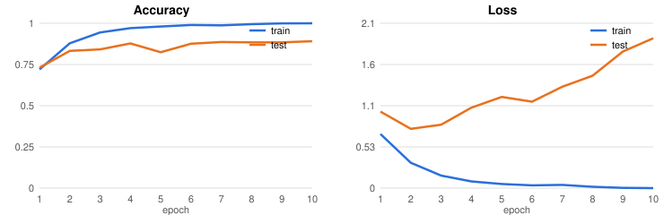
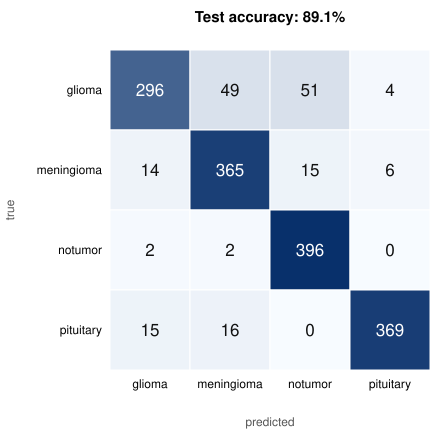
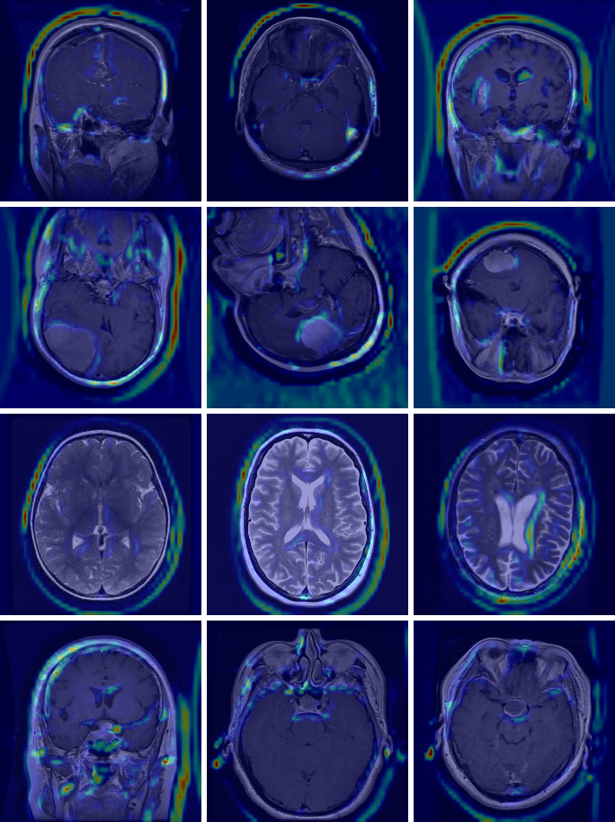

# Brain Tumor MRI Classification with Grad-CAM

**Live results page:** https://computer347.github.io/brain-mri-gradcam/

> Companion project: [3d_mri](https://github.com/computer347/3d_mri), 3D tumor segmentation
> on BraTS 2024 with lesion-level false-positive removal.

A convolutional neural network that classifies brain MRI slices into four categories —
**glioma**, **meningioma**, **pituitary tumor**, and **no tumor** — and uses
**Grad-CAM** to show which regions of each scan drove the prediction.

The point is not only accuracy but *explainability*: a heatmap lets a reviewer check whether
the model is looking at the tumor or at something irrelevant. In this project it turned out
to be the second case surprisingly often (see [What the heatmaps reveal](#what-the-heatmaps-reveal)).

## Results

Full dataset, 10 epochs, CPU only (about 7 minutes).

| Metric | Value |
|---|---|
| Test accuracy | **89.1%** (1426 / 1600) |
| Glioma recall | 74.0% |
| Meningioma recall | 91.3% |
| No tumor recall | 99.0% |
| Pituitary recall | 92.3% |





Most errors are gliomas classified as meningioma or "no tumor". Training accuracy reaches 100%
while test loss climbs after epoch 2, so the model is clearly overfitting.

### Grad-CAM examples

Three random test scans per class (rows: glioma, meningioma, no tumor, pituitary).
11 of the 12 are classified correctly; the third glioma is predicted as meningioma (80% confidence).



### What the heatmaps reveal

In many examples the strongest activation is on the **skull edge and the background around the head**,
not on the lesion. For example, in the second row the meningiomas are clearly visible, yet the heat sits
on the skull rim. This suggests the network partly relies on **shortcut features**, such as image framing,
contrast or the scanner and source differences between classes, rather than purely on tumor
appearance. Accuracy alone would hide this; Grad-CAM makes it visible.

## How it works

1. Loads images from `Training/` and `Testing/` (all images, or `N_PER_CLASS` per class).
2. Resizes to 224×224 and normalizes to [0, 1].
3. Trains a compact CNN (3 × Conv2D + MaxPool → Dense(64) → 4 logits) with Adam and cross-entropy.
4. Evaluates on the test set and computes a confusion matrix.
5. Runs Grad-CAM on the last convolutional layer for 3 random test scans per class.
6. Writes everything to `results/`: `training_curves.svg`, `confusion_matrix.svg`,
   `gradcam_grid.png`, per-example scan/heatmap PNGs and `metrics.json`.

Charts are written as plain SVG and images via `tf.io.encode_png` (see `plots.py`),
so the only dependencies are TensorFlow and NumPy.

## Run it

```bash
pip install -r requirements.txt
# full dataset (as in the results above)
N_PER_CLASS=0 python MRI_Project_Exploration.py
# quick run on 200 images per class (default)
python MRI_Project_Exploration.py
```

Environment variables: `N_PER_CLASS` (default 200, `0` = all) and `EPOCHS` (default 10).

To refresh the results page, copy `results/` to `docs/results/`.
The page is served by GitHub Pages from the `docs/` folder.

## Dataset

[Brain Tumor MRI Dataset](https://www.kaggle.com/datasets/masoudnickparvar/brain-tumor-mri-dataset)
by Masoud Nickparvar (Kaggle), which combines the figshare, SARTAJ and Br35H collections.
The raw images are **not included in this repository**; the README and results page show only
12 resized test scans as examples. Download the dataset from Kaggle (see its page for license terms)
and place it next to the script as:

```
Training/{glioma,meningioma,notumor,pituitary}/*.jpg
Testing/{glioma,meningioma,notumor,pituitary}/*.jpg
```

This run used 5,600 training images (1,400 per class) and 1,600 test images (400 per class).

## Limitations and next steps

- The test set is also used as validation data during training, so the reported accuracy is slightly optimistic.
  Next: a separate validation split, with `Testing/` held out until the end.
- Overfitting: add data augmentation, dropout and early stopping.
- Transfer learning (EfficientNet / ResNet) and skull-stripping or brain-masking, to remove the
  shortcut cues that Grad-CAM exposed.
- Grad-CAM on a 26×26 feature map is coarse; try Grad-CAM++ or higher-resolution layers.
- Interactive demo: upload a scan → prediction + heatmap.

## Disclaimer

Research and educational project only. Not a medical device and not intended for clinical diagnosis.
